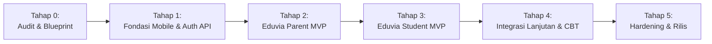

# EDUVIA MOBILE ECOSYSTEM — PHASED IMPLEMENTATION PLAN
**Document ID:** `EDV-MOB-PLAN-001`  
**Version:** 1.0.0 (Tahap 0 Baseline)  
**Target Systems:** Eduvia Parent App & Eduvia Student App  
**Status:** Active Implementation Roadmap  

---

## 1. Ikhtisar Rencana Kerja & Urutan Tahapan

Rencana implementasi ekosistem mobile Eduvia dirancang secara berurutan dan terukur tanpa mengganggu stabilitas web Eduvia yang sudah berjalan.

---

## 2. Rincian Setiap Tahapan

### Tahap 0 — Audit Repository & Keputusan Arsitektur (Status: Selesai)
* **Tujuan:** Mengaudit seluruh komponen backend, database, role, permission, serta model akademik yang sudah ada di `C:\Antigravity\Eduvia` dan menyusun blueprint arsitektur resmi.
* **Deliverables:**
  - `docs/mobile/ARCHITECTURE.md` (Topologi sistem, prinsip non-negotiable, Sanctum auth, tenant scoping).
  - `docs/mobile/FEATURE_MATRIX.md` (Pemetaan komparatif fitur web vs parent vs student).
  - `docs/mobile/API_CONTRACT.md` (Spesifikasi REST API lengkap dengan format `ApiResponse`).
  - `docs/mobile/UI_UX_GUIDELINES.md` (Standar visual resmi Eduvia Red `#E11D2E`, tipografi, safe areas).
  - `docs/mobile/IMPLEMENTATION_PLAN.md` (Dokumen ini).
* **Kriteria Selesai (DoD):** Seluruh dokumen diverifikasi terhadap implementasi riil repository.

---

### Tahap 1 — Fondasi Mobile & Auth API (Status: Siap Dijalankan)
* **Tujuan:** Membangun lapisan autentikasi API token (Laravel Sanctum) di backend dan menyiapkan fondasi monorepo mobile.
* **Tugas Backend:**
  1. Pasang paket `laravel/sanctum` di backend tanpa merusak autentikasi web session.
  2. Tambahkan trait `HasApiTokens` pada model `User`.
  3. Konfigurasi migrasi `personal_access_tokens` dan jalankan migrasi.
  4. Implementasikan `Api\AuthController` (`login`, `logout`, `me`) dengan validasi peran (`parent` / `student`) dan format `ApiResponse`.
  5. Buat Unit & Feature Test untuk autentikasi API (`ApiAuthTest.php`).
* **Tugas Mobile:**
  1. Inisialisasi struktur monorepo di `mobile/` (atau direktori kerja mobile) dengan React Native + Expo:
     - `apps/parent`: Aplikasi khusus orang tua.
     - `apps/student`: Aplikasi khusus siswa.
     - `packages/shared`: Shared design system, Axios client dengan secure interceptors, dan TypeScript definitions.
  2. Konfigurasi environment switching (`DEV`, `STAGING`, `PROD`).
  3. Implementasikan Secure Storage (`expo-secure-store`) untuk token.
* **Kriteria Selesai (DoD):**
  - Akun orang tua dan siswa dapat login via API dan mendapatkan token resmi.
  - Token dicabut dengan benar saat logout.
  - Web Eduvia tetap berfungsi normal (`php artisan test` lolos).

---

### Tahap 2 — Eduvia Parent MVP
* **Tujuan:** Mengimplementasikan alur lengkap untuk orang tua memantau kehadiran, jadwal, pengumuman, dan nilai resmi anak.
* **Fitur Utama:**
  1. **Autentikasi & Profil Orang Tua:** Form login berdesain modern, profil orang tua.
  2. **Multi-Child Switcher:** Pemilihan anak aktif yang terverifikasi via `parent_student_relations`.
  3. **Klaim Kode Penautan (Link Code):** Form klaim kode undangan anak dari sekolah.
  4. **Dasbor Orang Tua:** Ringkasan presensi %, pengumuman penting, tugas mendatang anak.
  5. **Kehadiran & Jadwal:** Kalender kehadiran bulanan dan jadwal mingguan.
  6. **Rapor Digital Terbit:** Daftar rapor resmi berstatus `published` beserta unduhan PDF.
* **Kriteria Selesai (DoD):**
  - Otorisasi IDOR teruji (orang tua dilarang mengakses data anak lain).
  - Seluruh data berasal dari endpoint server riil.

---

### Tahap 3 — Eduvia Student MVP
* **Tujuan:** Mengimplementasikan ruang belajar mandiri siswa di perangkat mobile.
* **Fitur Utama:**
  1. **Autentikasi Siswa:** Login siswa dan profil akademik (NISN, kelas, wali kelas).
  2. **Dasbor Belajar Siswa:** Jadwal pelajaran hari ini, materi baru, dan tugas mendesak.
  3. **Jadwal Pelajaran:** Kalender mata pelajaran mingguan.
  4. **Materi Pembelajaran:** Akses materi bacaan, dokumen, dan tautan pembelajaran.
  5. **Tugas & Pengumpulan:** Melihat instruksi tugas, batas waktu, dan mengunggah berkas jawaban.
  6. **Nilai & E-Rapor:** Nilai tugas dan rapor resmi yang telah dipublikasikan.
* **Kriteria Selesai (DoD):**
  - Siswa hanya dapat mengakses konten kelas yang aktif.
  - Pengumpulan tugas tervalidasi di server tanpa duplikasi.

---

### Tahap 4 — Integrasi Lanjutan & CBT Mobile
* **Tujuan:** Fitur tingkat lanjut mencakup CBT mobile, komunikasi sekolah, dan modul keuangan orang tua.
* **Fitur Utama:**
  1. **Mesin CBT Mobile:**
     - Ruang ujian interaktif dengan timer server authoritative.
     - Autosave jawaban per nomor secara idempotent (`ExamAnswer::updateOrCreate`).
     - State recovery jika aplikasi tertutup.
     - Finalisasi otomatis jika waktu habis.
  2. **Komunikasi Guru - Orang Tua:**
     - Percakapan terstruktur antara orang tua dan wali kelas / guru mata pelajaran anak.
  3. **Keuangan & Pembayaran SPP (Orang Tua):**
     - Daftar tagihan, rincian pembayaran, unggah bukti transfer.
  4. **Push Notifications:**
     - Integrasi push notification untuk pengumuman, kehadiran, dan tagihan.
* **Kriteria Selesai (DoD):**
  - CBT mobile bekerja selaras dengan CBT web tanpa perbedaan data penilaian.

---

### Tahap 5 — Hardening, QA, & Persiapan Rilis
* **Tujuan:** Pengujian menyeluruh, audit keamanan API, optimasi performa, dan build release.
* **Aktivitas:**
  1. **Security Audit & Penetration Testing:** Pengujian IDOR, token hijacking, rate limiting, SQL injection, input sanitization.
  2. **Regression Testing Web & Mobile:** Memastikan 100% test suite backend lulus.
  3. **Cross-Device UI Testing:** Pengujian pada berbagai ukuran layar Android (resolusi kecil s/d tablet) dan iOS (iPhone notch, dynamic island, iPad).
  4. **Production Build & Distribution Setup:** Konfigurasi build APK/AAB Android dan IPA iOS, signing key, dan panduan rilis.
